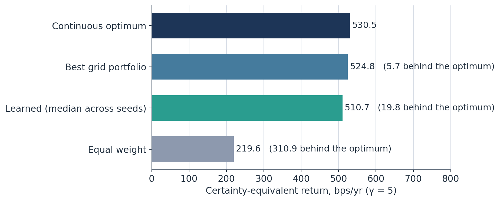
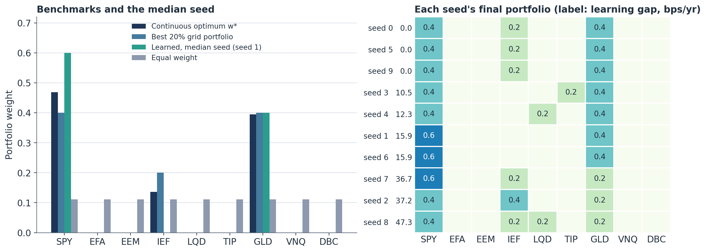

# Model-Free Q-Learning and Optimal Portfolio Choice with Nine Assets

**Albert Aldrich and William Harkless** · Wharton, Data Science for Finance, Fall 2026

**[Read the report (PDF)](docs/report/REPORT.pdf)** · [Slides (PDF)](docs/report/slides/slides.pdf) · [Assignment](assignment.pdf)

Can a reinforcement-learning agent find a near-optimal portfolio when it only
sees the rewards of its own choices, and never the expected returns or
covariances that generate them? We calibrate a Gaussian market from 20 years
of daily data on nine ETFs, solve for the mean-variance optimum exactly, train
a tabular Q-learning agent on simulated returns across ten random seeds, and
measure how close it gets. Two bonus extensions follow: function approximation
for large action sets, and transaction costs with drifting holdings.

## Results



At risk aversion γ = 5, choosing among the 1,287 long-only portfolios on a 20%
weight grid (report §5):

| | Certainty-equivalent return, bps/yr | Behind the optimum |
|---|---:|---:|
| Continuous long-only optimum | 530.5 | |
| Best portfolio on the 20% grid | 524.8 | 5.7 |
| Learned portfolio, median of 10 seeds | 510.7 | 19.8 |
| Equal weight (1/N) | 219.6 | 310.9 |

- **What it learned.** Every seed holds U.S. equities (SPY) and gold (GLD), as
  the optimum does, and eight of ten add a bond fund. As risk aversion rises
  the learned portfolios move toward bonds, as the optimum does.
- **How close it came.** The median seed is 14.1 bps/yr behind the best
  portfolio it was allowed to pick. Three of ten seeds find that portfolio
  exactly at γ = 5, and five of ten at γ = 3 and γ = 8.
- **Why it stops short.** The two best grid portfolios differ by 10.5 bps/yr,
  while one 20-day episode's reward has a standard deviation near 3,900 bps/yr.
  Separating them reliably would take about a million tries of each; the
  agent's exploration gives each about a thousand.
- **Action-space design.** A finer grid removes discretization error and adds
  learning error. The pre-registered coarser 25% grid has a smaller median
  total gap than the 20% grid (14.3 against 19.8 bps/yr, §5.5). The post hoc
  10% grid (with 63-day episodes and 26M episodes) roughly breaks even with the
  20% grid at γ = 5 and is worse at γ = 3 and γ = 8 (§6.1).
- **Extensions (post hoc, with their failures reported).** Spline function
  approximation beats a constant-step table on the 20% grid at two of three
  risk aversions and ranks the whole action set well, but picks badly at the
  top. On the 10% grid it loses to the tabular agent, in a comparison that also
  changes the step-size rule (§6.3). With transaction costs and drifting
  holdings, on the three ETFs of the optimum, the agent trails a
  full-information oracle by 13.1 bps/yr at zero cost and 2.8 at $10 billion of
  assets. It loses to always-rebalancing at the three lower cost levels; at
  $10 billion its trade timing is worth 6.2 bps/yr, but most of the narrowing
  comes from a better target, which we have not explained (§6.4).



Only the four baseline experiments (γ = 5 on the 20% and 25% grids, γ = 3 and
γ = 8 on the 20% grid) had their settings fixed before any full-scale run.
Every other run is labeled post hoc in the report.

## Where each part of the assignment is

| Assignment part | Report | Code | Method notes |
|---|---|---|---|
| I. Data and ground-truth environment | §2 | [`src/data/`](src/data/), [`src/environment.py`](src/environment.py) | [`DATA_CLEANING.md`](docs/methods/DATA_CLEANING.md), [`ENVIRONMENT.md`](docs/methods/ENVIRONMENT.md) |
| II. Theoretical benchmarks | §3 | [`src/benchmarks/`](src/benchmarks/) | Derivation in report §3 |
| III. Reinforcement-learning design | §4 | [`src/action_space/grid.py`](src/action_space/grid.py), [`src/rewards.py`](src/rewards.py), [`src/agent.py`](src/agent.py), [`src/train.py`](src/train.py) | Settings and reasons in report Table 3, [`EXPERIMENTS.md`](docs/methods/EXPERIMENTS.md) |
| IV. Training and convergence | §5.1, §5.2 | [`src/run_experiments.py`](src/run_experiments.py), [`src/config.py`](src/config.py) | [`EXPERIMENTS.md`](docs/methods/EXPERIMENTS.md) |
| V. Comparison with the benchmarks, convergence speed | §5.3 to §5.6 | [`src/evaluate.py`](src/evaluate.py) | [`EVALUATION.md`](docs/methods/EVALUATION.md) |
| VI. Robustness and research challenges | §6.1, §6.2, §6.5 | Same runner, post hoc runs | [`EXPERIMENTS.md`](docs/methods/EXPERIMENTS.md) §7 |
| Bonus: function approximation | §6.3 | [`src/features.py`](src/features.py), [`src/fa_agent.py`](src/fa_agent.py), [`src/tune_fa.py`](src/tune_fa.py) | [`FA_INTEGRATION_NOTES.md`](docs/methods/FA_INTEGRATION_NOTES.md), [`EXPERIMENTS.md`](docs/methods/EXPERIMENTS.md) §8 |
| Bonus: transaction costs | §6.4, Appendix C | [`src/tc_drift/`](src/tc_drift/); first design in [`src/transaction_costs.py`](src/transaction_costs.py) | [`TC_DRIFT_DESIGN.md`](docs/methods/TC_DRIFT_DESIGN.md), [`TRANSACTION_COSTS.md`](docs/methods/TRANSACTION_COSTS.md) |

The agent never sees μ, Σ or the benchmarks. It receives only its action index
and a scalar reward, and unit tests check that its code does not import the
data loader, the benchmark module or the data files.

## Quick start

Python 3.10 or newer. From the repository root:

```bash
pip install -r requirements.txt
python -m pytest src/tests -q                  # test suite (see Tests below)
python -m src.data.clean                       # rebuild data/processed/ from the committed raw data
python -m src.run_experiments --dry-run        # print the four baseline experiments without training
python -m src.run_experiments --results-dir results/repro   # train and evaluate them, about 3.5 hours
python -m src.benchmarks.closed_form_table     # budget-only closed-form weights, results/benchmarks/
```

Training is seeded. Compare `results/repro/` with
[`results/INDEX.md`](results/INDEX.md); a re-run of 30,000 episodes of three
seeds matched the saved logs bit for bit on the original machine
(`RUN_ISSUES_2026-10-22.md`), and another platform may differ in the last
floating-point digits. The large
training logs (`run_*.npz`) are not committed, so `src.run_experiments`
refuses to re-evaluate a committed results folder; train into a new folder
instead.

Do not re-run `src.data.download_raw`. The raw data (downloaded 2026-09-24) is
committed because Yahoo restates adjusted prices, and a new download would
change the calibration.

## Reproducing everything else

**Post hoc tabular and function-approximation runs.** Each has a run id and
its own folder, for example:

```bash
python -m src.run_experiments --run b63 --results-dir results/b63
```

[`EXPERIMENTS.md`](docs/methods/EXPERIMENTS.md) §7 lists the tabular variants
(`eps-decay`, `b63`, `n26m`, `all-three`, `grid10-robustness`) and §8 the
constant-step and function-approximation runs (`tabular-const`,
`fa-quadratic`, `fa-spline`, and `fa-spline-grid10-eps3` and `-eps10` in §8.8,
committed in folders with a `_2026-11-11` suffix), each with its command,
registered expectation and run time.

**Transaction costs with drift** (the reported extension,
[`TC_DRIFT_DESIGN.md`](docs/methods/TC_DRIFT_DESIGN.md)):

```bash
python -m src.tc_drift.run all --workers 7      # 4 cost levels x 10 seeds, then scoring
python -m src.tc_drift.run train --level aum_1b --seed 0   # one run
python -m src.tc_drift.run evaluate --level aum_1b         # score one level (--seeds 0 1 2 for fewer)
python -m src.tc_drift.report                   # rebuild reports/tc-drift/report.html from committed files
```

Levels are `zero`, `aum_100m`, `aum_1b` and `aum_10b`. The full batch took
2 h 14 min on a 10-core Mac (2026-11-20). The six oracle tables
(`results/tc-drift/oracle/*.npz`) are committed, and `run.py` checks them
against `results/tc-drift/oracle/summary.json`. To rebuild them yourself, run
`python -m src.tc_drift.oracle_runs` (8,452 s for the committed tables), then
`git checkout results/tc-drift/oracle/summary.json`; before restoring,
`git diff` should show changes only in `provenance`, `created_utc` and
`runtime_seconds`. All 40 reported runs came from clean commit `1787f0d`.
Results, including the twelve registered expectations and their verdicts, are
in [`results/tc-drift/runs/README.md`](results/tc-drift/runs/README.md).

**The first transaction-cost design** (kept as a negative result,
[`TRANSACTION_COSTS.md`](docs/methods/TRANSACTION_COSTS.md)):

```bash
python -m src.transaction_costs experiments/transaction-costs/quadratic-cost.json --dry-run
python -m src.tc_sweep_report      # rebuilds reports/tc-quadratic-cost/
```

On Windows, set `$env:PYTHONIOENCODING = "utf-8"` before `src.tc_sweep_report`.

**Per-run HTML reports**, rebuilt from committed files
([`reports/README.md`](reports/README.md)):

```bash
python -m src.reporting.build --all
```

**The report and slides.** `sh docs/report/build.sh` regenerates every figure
(`docs/report/figures/make_figures.py`), typesets `docs/report/REPORT.md` into
`REPORT.pdf` with pandoc and XeLaTeX, and rebuilds the slide deck. It needs
pandoc, TeX Live (xelatex, latexmk, libertinus-otf) and Google Chrome; set `PY`, `PANDOC`
and `CHROME` if they are not at the macOS paths the script assumes.

## Requirements

`requirements.txt` pins the Python 3.10 set (numpy 2.2.6, scipy 1.15.3,
pandas 2.3.3, matplotlib 3.10.9, yfinance 1.7.0, requests 2.33.1,
pytest 9.1.1). The committed data and results were produced with Python
3.13.9, numpy 2.3.5, scipy 1.16.3, pandas 2.3.3, matplotlib 3.10.6 and
yfinance 1.7.0. The test suite passes under both sets apart from the one
known failure below (`DATA_CLEANING.md` §7.5), and rebuilding `data/processed/`
with the Python 3.10 set matches the committed files to floating-point
rounding (largest relative difference in Σ 3.7e-15, 2026-11-26).

## Seeds

All reported randomness comes from master seed **20261016**
([`src/config.py`](src/config.py)). It is split into separate streams for
training returns, the agent's exploration and evaluation (`SeedPlan` in
[`src/environment.py`](src/environment.py)), and each run's manifest records
the plan. Seed i sees the same simulated returns in every run with the same
episode length and grid, so those runs compare seed by seed.
Step sizes for the constant-step runs were tuned on master seed
**20261103** and the transaction-cost agent on **20261112**, never on the
reported seed.

## Tests

`python -m pytest src/tests -q` runs 761 tests in about 12 minutes. On 2026-11-26, on Windows with the
`requirements.txt` set (Python 3.10.2), 760 passed. The one known failure,
`test_committed_report_matches_a_rebuild`, compares the committed
transaction-cost HTML report byte for byte with a rebuild, and fails wherever
matplotlib differs from the version that built it (3.10.6); the report's
`data.json` rebuilds identically ([`reports/README.md`](reports/README.md)).
On the Mac that produced the results (Python 3.13), 758 of the then 758 tests passed on 2026-11-20.

## Expected outputs

| Where | What |
|---|---|
| [`results/README.md`](results/README.md) | Map of the results folder: which run each subfolder holds and the report section it feeds |
| `results/INDEX.md` | Summary of the four baseline experiments |
| `results/<experiment>/evaluation/` | `summary.json`, CSV tables (per seed, weights, performance) and figures (weights, learning curve, cumulative regret, losses by seed) |
| `results/<run_id>/INDEX.md` | Summary of each post hoc run |
| `results/benchmarks/` | Budget-only closed-form weights and their check against a numerical solve |
| `results/tc-drift/runs/<level>/` | The 40 transaction-cost runs: `summary.json`, `per_seed.csv`, per-seed records and logs |
| `reports/<run_id>/report.html` | One self-contained HTML report per run, compared with earlier runs |
| `docs/report/REPORT.pdf`, `docs/report/slides/slides.pdf` | The report and the slides |

## Repository layout

| Folder | What |
|---|---|
| [`src/`](src/) | All code; tests in `src/tests/` |
| [`data/`](data/) | `raw/` (committed, never re-downloaded) and `processed/` (rebuilt by `src.data.clean`), with the cleaning log |
| [`results/`](results/) | Run manifests, evaluation summaries, tables and figures ([`results/README.md`](results/README.md)) |
| [`reports/`](reports/) | One interactive HTML report per run |
| [`experiments/`](experiments/) | Configuration files for the first transaction-cost design |
| [`docs/report/`](docs/report/) | The report (`REPORT.md`, `REPORT.pdf`), its figures and LaTeX build, the slides, and earlier drafts in `drafts/` |
| [`docs/methods/`](docs/methods/) | How each part works, with every decision and assumption written down |
| [`docs/reviews/`](docs/reviews/), [`docs/notes/`](docs/notes/), [`docs/PROJECT_PROSPECTUS.md`](docs/PROJECT_PROSPECTUS.md) | The project record: plan and ownership, audits, review history and team notes ([`docs/README.md`](docs/README.md)) |

[`CLAUDE.md`](CLAUDE.md) is the team's working agreement for AI-assisted
sessions with Claude Code, and `.claude/no-ai-slop/` holds the writing-style
checklist it applies (third-party, MIT licensed).
